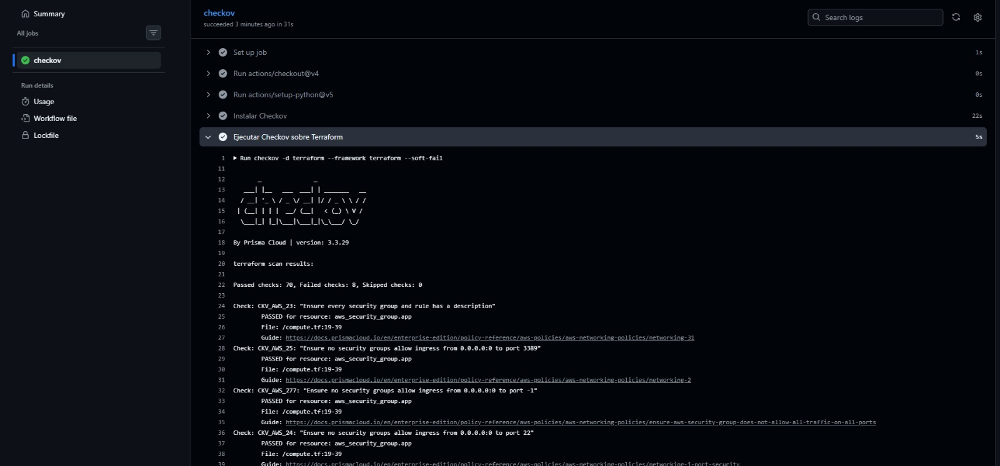
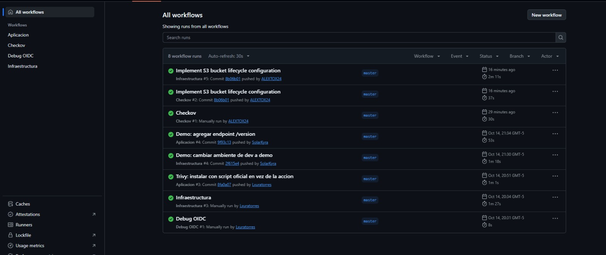
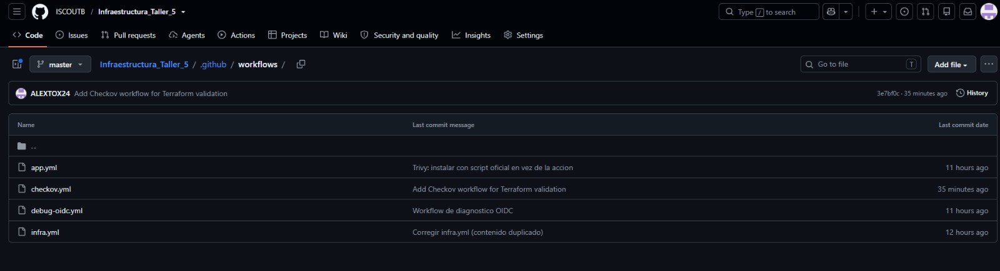

# Taller 5: servicio con almacenamiento persistente de objetos

Servicio web minimo para cargar y consultar archivos. La aplicacion corre dentro de un contenedor Docker en una instancia EC2 y conserva los archivos en Amazon S3, fuera del contenedor.

Repositorio: https://github.com/ISCOUTB/Infraestructura_Taller_5

Aplicacion publicada: http://32.192.73.161

## Arquitectura

```text
Desarrollador --push--> GitHub Actions
                          |-- OIDC (sin claves) --> AWS
                          |-- terraform apply ----> S3 (archivos) + ECR (imagen) + EC2
                          |-- build + Trivy + push -> ECR
                          '-- SSM Run Command ----> EC2

Cliente HTTP --puerto 80--> EC2 (Docker)
EC2 --rol IAM--> S3 (lee y escribe archivos)
EC2 --rol IAM, solo lectura--> ECR (descarga la imagen)
```

### Flujo de despliegue

1. Un cambio en `terraform/` ejecuta el workflow **Infraestructura**. Se formatea, valida y analiza con Checkov; si no es un pull request, Terraform aplica los cambios en AWS.
2. Un cambio en `app/` o en `Dockerfile` ejecuta el workflow **Aplicacion**. Este construye la imagen, ejecuta Trivy, la publica en ECR con el SHA del commit y la despliega en EC2 usando AWS Systems Manager (SSM).
3. La instancia ejecuta el contenedor con el puerto interno `8000` publicado como HTTP en el puerto `80`.
4. Los archivos no se guardan en el sistema de archivos del contenedor: la app los escribe directamente en S3.

## API

La URL base de la demostracion es `http://32.192.73.161`.

| Metodo | Ruta | Funcion |
| --- | --- | --- |
| GET | `/health` | Comprueba que la aplicacion esta disponible. |
| GET | `/version` | Devuelve la version configurada en `APP_VERSION`. |
| POST | `/files` | Recibe un archivo multipart en el campo `file` y lo guarda en S3. |
| GET | `/files` | Lista las claves de los archivos almacenados en S3. |

Ejemplos:

```bash
curl http://32.192.73.161/health
curl http://32.192.73.161/version
curl -F "file=@archivo.txt" http://32.192.73.161/files
curl http://32.192.73.161/files
```

## Infraestructura como codigo

Terraform crea o administra:

- Un bucket S3 privado con bloqueo de acceso publico, versionado y cifrado del lado del servidor con AES256.
- Un repositorio ECR con escaneo al publicar, cifrado y politica de retencion de las cinco imagenes mas recientes.
- Una instancia EC2 `t3.micro` basada en Amazon Linux 2023, con disco `gp3` cifrado de 8 GB.
- Un grupo de seguridad que expone solamente HTTP en el puerto 80 y permite salida a Internet.
- Un rol IAM para EC2 con `s3:ListBucket` sobre el bucket y `s3:GetObject`/`s3:PutObject` sobre sus objetos.
- Permisos de lectura del repositorio ECR y acceso SSM para permitir el despliegue remoto sin SSH.
- Etiquetas comunes de equipo, proyecto y ambiente mediante `default_tags`.

### Variables principales

Las variables se definen en [terraform/variables.tf](terraform/variables.tf):

| Variable | Valor predeterminado | Uso |
| --- | --- | --- |
| `aws_region` | `us-east-1` | Region de AWS. |
| `team` | `equipo-proyectoTIUTB` | Etiqueta del equipo. |
| `project` | `taller5-almacenamiento` | Etiqueta del proyecto. |
| `environment` | `demo` | Ambiente de despliegue. |
| `instance_type` | `t3.micro` | Tipo de instancia EC2. |
| `image_tag` | `latest` | Variable reservada para la version de imagen. |

El nombre del bucket se genera con el identificador de la cuenta para que sea globalmente unico. El estado de Terraform se almacena en el bucket remoto `taller5-tfstate-478400396947`, cifrado y con bloqueo mediante `use_lockfile`.

## Preparacion inicial (una sola vez)

Estos pasos se hacen a mano porque Terraform y los workflows dependen de ellos. Requieren una identidad de AWS con permisos de IAM y S3 (por ejemplo, un usuario con `IAMFullAccess` y `AmazonS3FullAccess`). Reemplazar `<CUENTA>` por el ID de la cuenta de AWS y `<ORG>/<REPO>` por el repositorio de GitHub.

1. **Bucket del estado de Terraform** (no lo gestiona Terraform, para que sobreviva a `terraform destroy`):

```bash
aws s3api create-bucket --bucket taller5-tfstate-<CUENTA> --region us-east-1
aws s3api put-bucket-versioning --bucket taller5-tfstate-<CUENTA> --versioning-configuration Status=Enabled
```

2. **Proveedor OIDC de GitHub** en AWS:

```bash
aws iam create-open-id-connect-provider --url https://token.actions.githubusercontent.com --client-id-list sts.amazonaws.com
```

3. **Rol `taller5-github-actions`** con politica de confianza para el repositorio. Las organizaciones con identificador personalizado, como ISCOUTB, presentan el `sub` con la forma `repo:<ORG>@<ID>/<REPO>@<ID>:ref:...`, por eso la condicion usa comodines:

```json
"StringLike": {
  "token.actions.githubusercontent.com:sub": "repo:ISCOUTB@*/Infraestructura_Taller_5@*:*"
}
```

```bash
aws iam create-role --role-name taller5-github-actions --assume-role-policy-document file://trust-policy.json
for p in AmazonEC2FullAccess AmazonS3FullAccess IAMFullAccess AmazonSSMFullAccess AmazonEC2ContainerRegistryFullAccess; do
  aws iam attach-role-policy --role-name taller5-github-actions --policy-arn arn:aws:iam::aws:policy/$p
done
```

4. Ajustar en el repositorio el nombre del bucket de estado (`terraform/providers.tf`) y el ARN del rol (`AWS_ROLE_ARN` en `infra.yml` y `app.yml`).

## Despliegue

El despliegue normal se realiza haciendo push a la rama `main` o `master`. Los workflows se ejecutan segun las rutas modificadas y tambien pueden iniciarse manualmente con `workflow_dispatch`. Orden recomendado la primera vez: primero **Infraestructura** (crea ECR, S3 y EC2) y despues **Aplicacion**.

Para ejecutar Terraform localmente se necesita Terraform `>= 1.10.0` y credenciales de AWS:

```bash
cd terraform
terraform init
terraform fmt -check -recursive
terraform validate
terraform plan
terraform apply
```

En el flujo habitual no se guardan claves de AWS en el repositorio ni en la imagen. GitHub Actions usa el rol `taller5-github-actions` mediante OIDC y la aplicacion usa el rol asociado a EC2 mediante la cadena de credenciales automatica de `boto3`.

## Pipeline de CI/CD (GitHub Actions)

| Workflow | Archivo | Que hace |
|---|---|---|
| Infraestructura | `infra.yml` | `fmt`, `init`, `validate`, Checkov, y luego `plan` y `apply` en AWS. |
| Aplicacion | `app.yml` | Construye la imagen, la analiza con Trivy, la publica en ECR con el SHA del commit y la despliega en EC2 por SSM. |
| Checkov | `checkov.yml` | Ejecuta Checkov de forma independiente sobre `terraform/`. |
| Debug OIDC | `debug-oidc.yml` | Diagnostico usado para descubrir el formato del `sub` de OIDC. Se conserva como referencia. |

Seguridad del pipeline: sin claves de acceso (OIDC), permisos de workflow `id-token: write` y `contents: read`, sin SSH (puerto 22 cerrado), ECR con tags inmutables y escaneo al publicar.

## Resultados de seguridad

### Checkov

| Ejecucion | Aprobados | Fallidos |
|---|---|---|
| Primera ejecucion | 68 | 9 |
| Despues de agregar ciclo de vida al bucket S3 | 70 | 8 |



Los fallos restantes se aceptaron de forma consciente porque exigen recursos adicionales con costo o van contra el objetivo de la demostracion:

- Replicacion entre regiones, cifrado con KMS, logging de acceso y notificaciones de eventos en S3.
- Puerto 80 abierto a Internet: la API debe ser accesible para la demostracion. No se abre SSH.
- Salida abierta a Internet en el grupo de seguridad: la instancia descarga la imagen de ECR y habla con S3.
- IP publica en la EC2: necesaria para probar la API sin balanceador.

### Trivy

Analiza la imagen buscando vulnerabilidades CRITICAL y HIGH y guarda el reporte como artefacto `evidencia-trivy` en cada ejecucion de **Aplicacion**. Con `--exit-code 0` no bloquea el despliegue.

## Evidencias de la entrega

- Workflows **Infraestructura** y **Aplicacion** en verde, incluidos los dos cambios de la demostracion:



- Cambio de infraestructura: `environment` pasa de `dev` a `demo` (commit "Demo: cambiar ambiente de dev a demo").
- Cambio de aplicacion: nuevo endpoint `/version` (commit "Demo: agregar endpoint /version").
- Artefactos `evidencia-checkov` y `evidencia-trivy` en la pagina de cada ejecucion.
- Aplicacion respondiendo en http://32.192.73.161 (`/health`, `/version`, `POST /files` y `GET /files`).
- Bucket de S3 con el archivo cargado.

<!-- PENDIENTE: agregar aqui las capturas de Trivy, de la app respondiendo y del bucket en S3 (carpeta docs/). -->



## Decisiones

- **S3 para persistencia:** los archivos sobreviven si el contenedor o la EC2 se reemplazan.
- **EC2 con Docker:** cumple el requisito de ejecutar en una maquina virtual y mantiene la solucion simple.
- **OIDC para GitHub Actions:** evita access keys de larga duracion en secretos.
- **Rol IAM para la aplicacion:** sin credenciales en la imagen, acceso limitado a un bucket y un repositorio ECR.
- **SSM en lugar de SSH:** despliegue remoto sin abrir el puerto 22.
- **ECR en lugar de un registro externo:** la EC2 descarga la imagen con su propio rol, sin claves.
- **Tags inmutables por SHA:** cada despliegue identifica exactamente el commit construido.
- **Bucket de estado fuera de Terraform:** sobrevive a la destruccion de la infraestructura.
- **Instalacion de Trivy con script oficial:** la accion de terceros fallaba al resolver versiones.

## Limitaciones y posibles mejoras

- Sin autenticacion: cualquiera con la IP puede listar o cargar archivos (intencional para la demostracion).
- Sin limites de tamano, validacion de tipos, nombres unicos ni paginacion.
- Solo HTTP: sin HTTPS, dominio, balanceador ni alta disponibilidad.
- Checkov con `soft_fail` y Trivy con `--exit-code 0`: informan pero no bloquean. Mejora: volverlos estrictos.
- El script de Trivy se descarga de la rama `main` sin version fija. Mejora: fijar version.
- Los permisos del rol de GitHub Actions son amplios (`*FullAccess`). Mejora: acotarlos a lo que Terraform necesita.
- `force_destroy` y `force_delete` facilitan el desmontaje; no usar asi en produccion.
- Mejoras posibles: HTTPS con balanceador, KMS, logging de S3, WAF y autenticacion.

## Destruccion de recursos

1. Con credenciales de AWS, destruir lo que gestiona Terraform:

```bash
cd terraform
terraform destroy
```

Verificar antes que no haya archivos que conservar: `force_destroy = true` borra el bucket aunque tenga objetos.

2. Borrar lo creado en la preparacion inicial (Terraform no lo gestiona):

```bash
aws s3 rb s3://taller5-tfstate-<CUENTA> --force
for p in $(aws iam list-attached-role-policies --role-name taller5-github-actions --query 'AttachedPolicies[].PolicyArn' --output text); do
  aws iam detach-role-policy --role-name taller5-github-actions --policy-arn $p
done
aws iam delete-role --role-name taller5-github-actions
aws iam delete-open-id-connect-provider --open-id-connect-provider-arn arn:aws:iam::<CUENTA>:oidc-provider/token.actions.githubusercontent.com
```

El bucket de estado tiene versionado: si `s3 rb --force` no lo vacia por completo, eliminar tambien las versiones desde la consola de S3.

3. Eliminar o desactivar las claves de acceso temporales de IAM y confirmar en la consola que no quedan recursos activos (EC2, S3, ECR).
