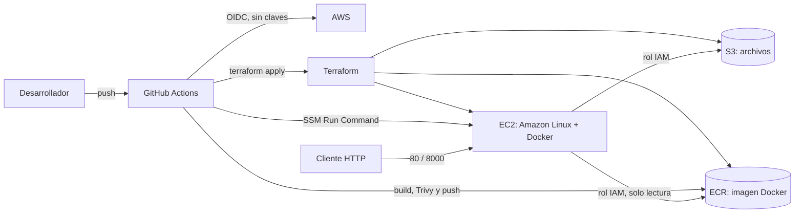

# Taller 5: servicio con almacenamiento persistente de objetos

Servicio web minimo para cargar y consultar archivos. La aplicacion corre dentro de un contenedor Docker en una instancia EC2 y conserva los archivos en Amazon S3, fuera del contenedor.

Repositorio: https://github.com/ISCOUTB/Infraestructura_Taller_5

Aplicacion publicada: http://32.192.73.161

## Arquitectura



### Flujo de despliegue

1. Un cambio en `terraform/` ejecuta el workflow **Infraestructura**. Se formatea, valida y analiza con Checkov; si no es un pull request, Terraform aplica los cambios en AWS.
2. Un cambio en `app/` o en `Dockerfile` ejecuta el workflow **Aplicacion**. Este construye la imagen, ejecuta Trivy, la publica en ECR con el SHA del commit y la despliega en EC2 usando AWS Systems Manager (SSM).
3. La instancia ejecuta el contenedor con el puerto interno `8000` publicado como HTTP en el puerto `80`.
4. Los archivos no se guardan en el sistema de archivos del contenedor: la app los escribe directamente en S3.

## API

La URL base de la demostracion es `http://32.192.73.161`.

| Metodo | Ruta | Funcion |
| --- | --- | --- |
| GET | `/health` | Comprueba que la aplicacion esta disponible. |
| GET | `/version` | Devuelve la version configurada en `APP_VERSION`. |
| POST | `/files` | Recibe un archivo multipart en el campo `file` y lo guarda en S3. |
| GET | `/files` | Lista las claves de los archivos almacenados en S3. |

Ejemplos:

```bash
curl http://32.192.73.161/health
curl http://32.192.73.161/version
curl -F "file=@archivo.txt" http://32.192.73.161/files
curl http://32.192.73.161/files
```

## Infraestructura como codigo

Terraform crea o administra:

- Un bucket S3 privado con bloqueo de acceso publico, versionado y cifrado del lado del servidor con AES256.
- Un repositorio ECR con escaneo al publicar, cifrado y politica de retencion de las cinco imagenes mas recientes.
- Una instancia EC2 `t3.micro` basada en Amazon Linux 2023, con disco `gp3` cifrado de 8 GB.
- Un grupo de seguridad que expone solamente HTTP en el puerto 80 y permite salida a Internet.
- Un rol IAM para EC2 con `s3:ListBucket` sobre el bucket y `s3:GetObject`/`s3:PutObject` sobre sus objetos.
- Permisos de lectura del repositorio ECR y acceso SSM para permitir el despliegue remoto sin SSH.
- Etiquetas comunes de equipo, proyecto y ambiente mediante `default_tags`.

### Variables principales

Las variables se definen en [terraform/variables.tf](terraform/variables.tf):

| Variable | Valor predeterminado | Uso |
| --- | --- | --- |
| `aws_region` | `us-east-1` | Region de AWS. |
| `team` | `equipo-proyectoTIUTB` | Etiqueta del equipo. |
| `project` | `taller5-almacenamiento` | Etiqueta del proyecto. |
| `environment` | `demo` | Ambiente de despliegue. |
| `instance_type` | `t3.micro` | Tipo de instancia EC2. |
| `image_tag` | `latest` | Variable reservada para la version de imagen. |

El nombre del bucket se genera con el identificador de la cuenta para que sea globalmente unico. El estado de Terraform se almacena en el bucket remoto `taller5-tfstate-478400396947`, cifrado y con bloqueo mediante `use_lockfile`.

## Despliegue

El despliegue normal se realiza haciendo push a la rama `main` o `master`. Los workflows se ejecutan automaticamente segun las rutas modificadas y tambien pueden iniciarse manualmente con `workflow_dispatch`.

Para ejecutar Terraform localmente se necesita Terraform `>= 1.10.0`, el proveedor AWS `~> 5.0` y una identidad AWS con permisos suficientes para administrar los recursos del taller:

```bash
cd terraform
terraform init
terraform fmt -check -recursive
terraform validate
terraform plan
terraform apply
```

En el flujo habitual no se guardan claves de AWS en el repositorio ni en la imagen. GitHub Actions usa el rol `taller5-github-actions` mediante OIDC. La aplicacion usa el rol asociado a EC2 mediante la cadena de credenciales automatica de `boto3`.

## Evidencias de la entrega

La demostracion debe conservar, como minimo, las siguientes evidencias:

- Ejecucion exitosa de los workflows **Infraestructura** y **Aplicacion** en GitHub Actions.
- Artefacto `evidencia-checkov` generado por `infra.yml`.
- Artefacto `evidencia-trivy` generado por `app.yml`.
- Respuesta de `GET /health` y `GET /version` en la aplicacion publicada.
- Carga de un archivo mediante `POST /files` y posterior aparicion en `GET /files`.
- Bucket visible en la consola de S3 con el archivo cargado.
- Cambio de infraestructura con `environment = "demo"` y cambio de aplicacion con el endpoint `/version`.

## Decisiones y limitaciones

### Decisiones

- **S3 para persistencia:** desacopla los archivos del ciclo de vida de EC2 y del contenedor; si el contenedor se reemplaza, los objetos permanecen.
- **EC2 con Docker:** cumple el requisito de ejecutar la aplicacion en un entorno administrado por AWS y mantiene la solucion sencilla para la demostracion.
- **OIDC para GitHub Actions:** evita guardar access keys de larga duracion en secretos del repositorio.
- **Rol IAM para la aplicacion:** evita incluir credenciales en la imagen y limita el acceso al bucket y al repositorio ECR concretos.
- **SSM en lugar de SSH:** permite desplegar de forma remota sin abrir el puerto 22 ni administrar llaves SSH.
- **Versionado, cifrado y bloqueo publico en S3:** agregan recuperacion basica, proteccion de datos en reposo y evitan que los objetos queden publicos accidentalmente.
- **Tags inmutables por SHA:** cada despliegue identifica exactamente la imagen construida por un commit.

### Limitaciones

- No hay autenticacion de usuarios: cualquier cliente que alcance la IP publica puede consultar o cargar archivos. Esto es intencional para el alcance de la demostracion.
- La API no implementa limites de tamano, validacion de tipos, nombres unicos ni paginacion de objetos.
- La instancia EC2 y el bucket usan recursos publicos o con salida a Internet; la seguridad depende del grupo de seguridad, IAM y la configuracion privada de S3.
- Checkov se ejecuta con `soft_fail: true` y Trivy con `--exit-code 0`; los reportes sirven como evidencia y deben revisarse, pero no bloquean por si solos el despliegue.
- La aplicacion se publica directamente por HTTP y no tiene HTTPS, dominio, balanceador ni alta disponibilidad.
- `force_destroy` en S3 y ECR facilita el desmontaje del taller, pero debe revisarse antes de reutilizar esta configuracion en produccion.
- La instancia `t3.micro` y el almacenamiento pueden generar costos mientras permanezcan creados.

## Destruccion de recursos

Al terminar la demostracion, destruir los recursos para evitar costos:

```bash
cd terraform
terraform destroy
```

La destruccion requiere una identidad con permisos de AWS para eliminar EC2, S3, ECR, IAM y los recursos relacionados. Verificar antes que no existan archivos que deban conservarse, ya que `force_destroy = true` permite eliminar el bucket aunque contenga objetos. Confirmar tambien en la consola de AWS que no queden recursos activos.
## Pipeline de CI/CD (GitHub Actions)

El repositorio tiene cuatro workflows en `.github/workflows/`:

| Workflow | Archivo | Qué hace |
|---|---|---|
| Infraestructura | `infra.yml` | Valida el Terraform (`fmt`, `init`, `validate`), lo escanea con Checkov y aplica los cambios en AWS (`plan` y `apply`). |
| Aplicacion | `app.yml` | Construye la imagen Docker, la analiza con Trivy, la publica en ECR y la despliega en la EC2 mediante SSM. |
| Checkov | `checkov.yml` | Ejecuta Checkov de forma independiente sobre la carpeta `terraform/`. |
| Debug OIDC | `debug-oidc.yml` | Workflow de diagnóstico usado para probar la conexión con AWS. |

### Decisiones de seguridad del pipeline

- **Sin claves de acceso:** los workflows entran a AWS con OIDC (`role-to-assume`). No hay claves guardadas en secretos, en el código ni dentro de la imagen.
- **Permisos mínimos en los workflows:** el bloque `permissions` solo incluye `id-token: write` y `contents: read`.
- **Permisos mínimos en la EC2:** el rol de la instancia solo puede listar, leer y escribir en el bucket S3 del taller, y solo descargar imágenes del repositorio ECR del taller.
- **Sin SSH:** el puerto 22 está cerrado. El despliegue se ejecuta con AWS Systems Manager (SSM).
- **ECR inmutable:** cada imagen se etiqueta con el hash del commit y no se puede sobrescribir. Además, el repositorio escanea las imágenes al recibirlas.
- **Trivy:** analiza la imagen buscando vulnerabilidades CRITICAL y HIGH, guarda el reporte como artefacto (`evidencia-trivy`) y no bloquea el despliegue (`--exit-code 0`), porque el objetivo del taller es mostrar el análisis.

## Resultados de seguridad (Checkov)

Checkov analiza la carpeta `terraform/` en `infra.yml` y también en `checkov.yml`, que se puede lanzar manualmente desde la pestaña Actions.

| Ejecución | Chequeos aprobados | Chequeos fallidos |
|---|---|---|
| Primera ejecución | 68 | 9 |
| Después de agregar el ciclo de vida al bucket S3 | 70 | 8 |


Los fallos restantes se aceptaron de forma consciente porque exigen recursos adicionales con costo o van en contra del objetivo de la demostración:

- Replicación entre regiones, cifrado con KMS, logging de acceso y notificaciones de eventos del bucket S3.
- Puerto 80 abierto a internet: la API debe ser accesible para la demostración. No se abre SSH.
- Salida abierta a internet en el grupo de seguridad: la instancia debe descargar la imagen desde ECR y comunicarse con S3.

Medidas aplicadas: bloqueo de acceso público, versionado, cifrado en reposo y reglas de ciclo de vida en S3; ECR inmutable con escaneo y ciclo de vida; IMDSv2 obligatorio, disco cifrado y permisos mínimos por rol IAM.

## Evidencias de ejecución


